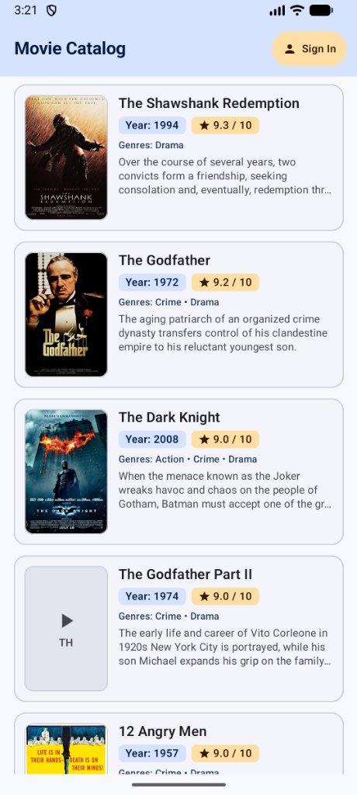
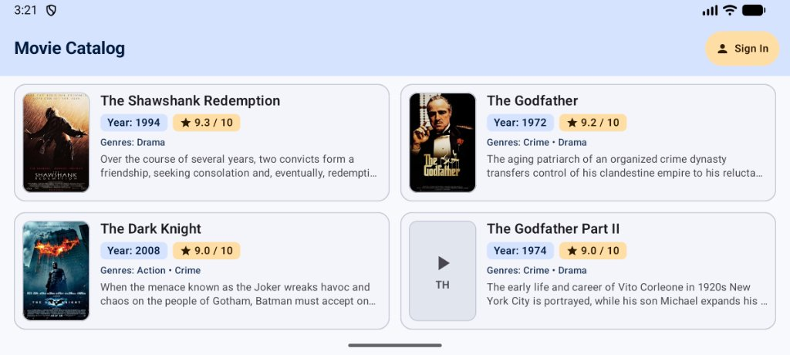
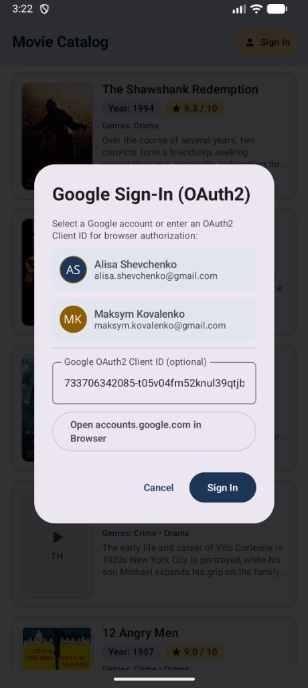
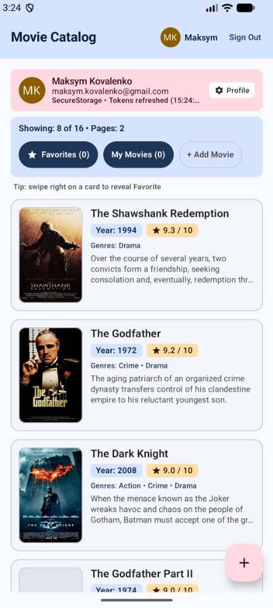
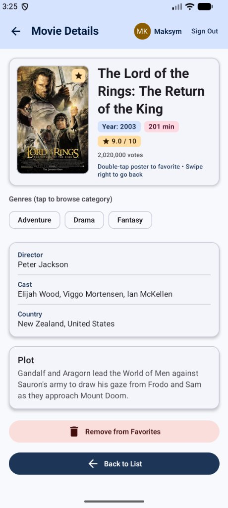
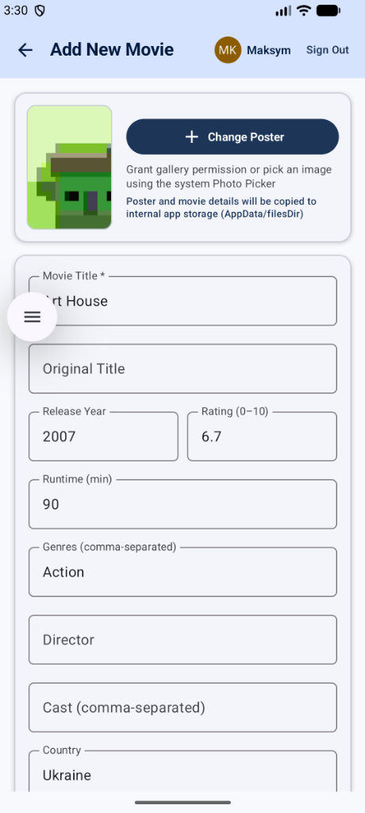
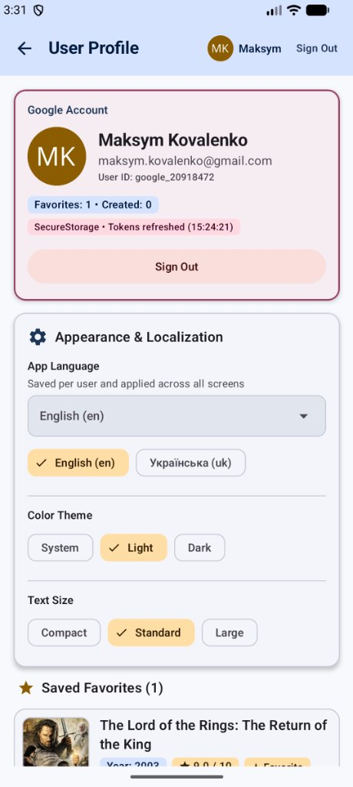
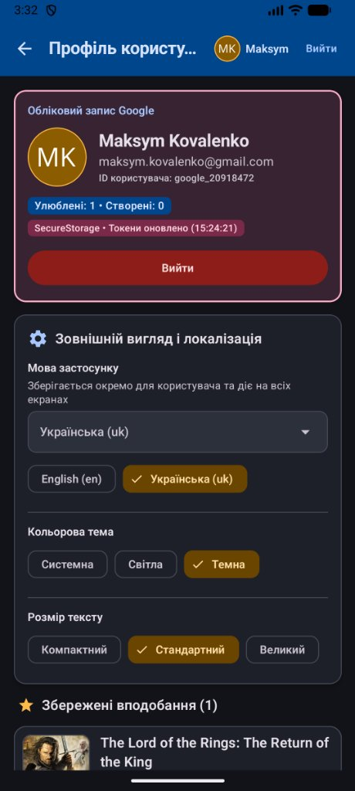

# MovieCatalog

MovieCatalog is an Android application built with Kotlin, Jetpack Compose, and Material 3. The application displays a movie catalog from the IMDb API and provides offline data, Google OAuth 2.0 authentication, encrypted token storage, user-created movie records, and dynamic English/Ukrainian localization.

---

## Screenshots

| Catalog (Signed Out) | Catalog (Landscape) | Google OAuth 2.0 Sign-In | Catalog (Signed In) |
| :---: | :---: | :---: | :---: |
|  |  |  |  |

| Movie Details & Genres | Create Movie (Photo Picker) | User Profile (`EN`) | User Profile (`UK` + Dark Theme) |
| :---: | :---: | :---: | :---: |
|  |  |  |  |

---

## Features

### 1. Movie Catalog and Pagination
- The application loads movie pages from `https://api.imdbapi.dev` (`/titles`, `/titles?pageToken=...`, and `/titles/{id}`).
- `CatalogViewModel` buffers loaded titles and reveals items in chunks of 6 during scroll via `LazyVerticalGrid` and `snapshotFlow`.
- `MovieApiService` supplies built-in fallback movie data when the network is unavailable.
- The grid shows 1 column in portrait orientation and 2 columns in landscape orientation.

### 2. Movie Details and Genre Navigation
- [`DetailsScreen`](app/src/main/java/com/example/moviecatalog/feature/details/DetailsScreen.kt) shows the poster, original title, release year, rating, runtime, vote count, director, cast, country, and plot summary.
- Users tap any genre chip (`AssistChip`) to open [`GenreMoviesScreen`](app/src/main/java/com/example/moviecatalog/feature/genre/GenreMoviesScreen.kt) and filter cached movies by genre.

### 3. Gestures, Animations, and Favorites
- `SwipeableMovieCard` reveals a right-swipe action panel (**Favorite** or **Delete**) without conflict with card tap navigation.
- Cards animate entrance (`alpha` and `translationY`) through `graphicsLayer` with `Animatable`, and scale on press with `animateFloatAsState`.
- Double-tapping the poster on [`DetailsScreen`](app/src/main/java/com/example/moviecatalog/feature/details/DetailsScreen.kt) toggles favorite status for signed-in users.
- Swiping right on [`DetailsScreen`](app/src/main/java/com/example/moviecatalog/feature/details/DetailsScreen.kt) returns to the previous screen.

### 4. Local Movie Creation and File Storage
- [`CreateMovieScreen`](app/src/main/java/com/example/moviecatalog/feature/create/CreateMovieScreen.kt) provides form fields with validation for title, year (`1888–2100`), rating (`0.0–10.0`), and positive runtime.
- The form requests media permission (`READ_MEDIA_IMAGES` or `READ_EXTERNAL_STORAGE`) and opens the system Photo Picker (`PickVisualMedia`).
- [`StorageService`](app/src/main/java/com/example/moviecatalog/data/local/StorageService.kt) copies selected posters to `context.filesDir/Posters/` and stores user-created and favorite movie lists in per-user JSON files.
- Users can delete their created movies together with copied poster files from internal storage.

### 5. Google OAuth 2.0 Authentication and Encrypted Storage
- [`AuthService`](app/src/main/java/com/example/moviecatalog/data/auth/AuthService.kt) implements OAuth 2.0 Authorization Code Flow with PKCE (`SHA-256`).
- `MainActivity` (`launchMode="singleTop"`) intercepts OAuth redirect URIs (`com.example.moviecatalog:/oauth2redirect` and reverse client ID scheme) and sends the authorization code to `oauth2.googleapis.com/token`.
- The sign-in dialog supports the preconfigured Android Client ID, a custom Client ID input, and local demo Google accounts with JWT `id_token` parsing.
- [`SecureStorage`](app/src/main/java/com/example/moviecatalog/data/local/SecureStorage.kt) encrypts `id_token`, `access_token`, `refresh_token`, `user_id`, and `client_id` using `AES/GCM/NoPadding` with keys stored in `AndroidKeyStore`.
- [`PreferencesStorage`](app/src/main/java/com/example/moviecatalog/data/local/PreferencesStorage.kt) stores non-sensitive profile metadata (`name`, `email`, `avatarUrl`, refresh timestamp) and UI preferences in `SharedPreferences`.
- On startup, `AuthService.restoreSessionWithRefreshToken()` refreshes the session automatically with the saved `refresh_token`.
- Favorite actions and movie creation stay locked until a user signs in.

### 6. User Profile, Localization, and Appearance
- [`ProfileScreen`](app/src/main/java/com/example/moviecatalog/feature/profile/ProfileScreen.kt) opens when a signed-in user taps the TopAppBar avatar or the catalog profile card.
- Users can switch language between **English (`en`)** and **Ukrainian (`uk`)**, select theme mode (**System**, **Light**, **Dark**), and adjust text size (**Compact `0.92x`**, **Standard `1.0x`**, **Large `1.12x`**).
- [`LocalizationService`](app/src/main/java/com/example/moviecatalog/data/local/LocalizationService.kt) saves language, theme mode, and font scale per `userId` and applies updates across all screens immediately.

---

## Technology Stack

| Layer | Technologies and Versions |
| :--- | :--- |
| **Language** | Kotlin `2.2.10` |
| **UI Framework** | Jetpack Compose (`BOM 2026.02.01`), Material 3, Material Icons Core |
| **Architecture** | MVVM, Unidirectional Data Flow, Clean Architecture layers, Coroutines, `StateFlow`, `SharedFlow` |
| **Navigation** | Navigation Compose `2.8.8` with `INavigationService` |
| **Lifecycle** | `androidx.lifecycle` (`runtime-ktx`, `viewmodel-compose`, `runtime-compose`) `2.8.7` |
| **Image Loading** | Coil Compose `2.7.0` |
| **Networking & JSON** | `java.net.HttpURLConnection`, `org.json.JSONObject`, `org.json.JSONArray` |
| **Security & Storage** | `AndroidKeyStore` (`AES/GCM/NoPadding`), `SharedPreferences`, `context.filesDir` JSON files |
| **Build & Android SDK** | Android Gradle Plugin `9.4.1`, `compileSdk 37`, `targetSdk 37`, `minSdk 24`, Java `11` |

---

## Architecture

1. **Layered Feature Packages**:
   - `domain/model` defines `@Immutable` domain models (`Movie`, `MoviePage`, `MovieCreateDto`, `UserProfile`).
   - `data/remote`, `data/local`, `data/auth`, and `data/repository` isolate network I/O, encrypted storage, preferences, and OAuth2 logic.
   - `feature/*` contains screens (`Catalog`, `Details`, `GenreMovies`, `CreateMovie`, `Profile`) and `ViewModel` classes that expose `@Immutable` UI state flows.
   - `core/designsystem`, `core/navigation`, and `ui/theme` contain shared components, Material 3 tokens, and navigation infrastructure.
2. **Single Source of Truth (`MovieRepository`)**:
   - [`MovieRepository`](app/src/main/java/com/example/moviecatalog/data/repository/MovieRepository.kt) combines remote API data, cached details, and per-user local files.
   - The repository observes `authService.currentUser` and loads or clears per-user JSON files on sign-in and sign-out.
3. **Manual Singleton DI Container (`MovieCatalogApp`)**:
   - [`MovieCatalogApp`](app/src/main/java/com/example/moviecatalog/MovieCatalogApp.kt) initializes lazy singletons (`preferencesStorage`, `secureStorage`, `authService`, `localizationService`, `movieApiService`, `storageService`, `movieRepository`, and `navigationService`).
   - Each `ViewModelProvider.Factory` injects required dependencies through interfaces.
4. **Decoupled Navigation (`INavigationService`)**:
   - `ViewModel` classes emit typed `NavigationCommand` events to a `SharedFlow`.
   - [`MovieCatalogNavHost`](app/src/main/java/com/example/moviecatalog/core/navigation/MovieCatalogNavHost.kt) collects commands and executes `NavController` transitions.
5. **Dynamic Localization (`ProvideAppLocalization`)**:
   - [`ProvideAppLocalization`](app/src/main/java/com/example/moviecatalog/data/local/LocalizationService.kt) overrides `LocalContext`, `LocalConfiguration`, `LocalResources`, and `LocalDensity` at the root composable in `MainActivity`.
   - Language, theme, and font scale changes update all screens without resetting navigation state.

---

## Project Structure

```text
app/src/main/
├── AndroidManifest.xml
├── res/
│   ├── values/strings.xml                  # Default English strings (en)
│   ├── values-uk/strings.xml               # Ukrainian strings (uk)
│   └── xml/locales_config.xml              # Supported app locales (en, uk)
└── java/com/example/moviecatalog/
    ├── MainActivity.kt                     # Entry point, OAuth2 intent handler, root theme/locale wrapper
    ├── MovieCatalogApp.kt                  # Application DI container for singletons
    ├── core/
    │   ├── designsystem/
    │   │   ├── MovieCard.kt                # MovieCard and SwipeableMovieCard composables
    │   │   └── MovieStyles.kt              # Container, poster frame, and badge modifiers
    │   └── navigation/
    │       ├── MovieCatalogNavHost.kt      # NavHost, TopAppBar, and GoogleSignInDialog
    │       └── NavigationService.kt        # Routes, NavigationCommand, and INavigationService
    ├── data/
    │   ├── auth/
    │   │   └── AuthService.kt              # Google OAuth2 PKCE, JWT parser, refresh_token flow
    │   ├── local/
    │   │   ├── LocalizationService.kt      # Per-user locale/theme/font state and ProvideAppLocalization
    │   │   ├── PreferencesStorage.kt       # SharedPreferences wrapper for profile metadata
    │   │   ├── SecureStorage.kt            # AES-GCM token storage backed by AndroidKeyStore
    │   │   └── StorageService.kt           # AppData poster copy and per-user JSON persistence
    │   ├── remote/
    │   │   └── MovieApiService.kt          # IMDb API client and offline fallback dataset
    │   └── repository/
    │       └── MovieRepository.kt          # Centralized cache and per-user data synchronization
    ├── domain/model/
    │   ├── Movie.kt                        # Movie and MoviePage models
    │   ├── MovieCreateDto.kt               # Create form DTO and field parsers
    │   └── UserProfile.kt                  # User profile model
    ├── feature/
    │   ├── catalog/                        # CatalogScreen and CatalogViewModel
    │   ├── create/                         # CreateMovieScreen and CreateMovieViewModel
    │   ├── details/                        # DetailsScreen and DetailsViewModel
    │   ├── genre/                          # GenreMoviesScreen and GenreMoviesViewModel
    │   └── profile/                        # ProfileScreen and ProfileViewModel
    └── ui/theme/                           # Color.kt, Shape.kt, Theme.kt, Type.kt
```

### Release Tags

| Tag | Milestone |
| :--- | :--- |
| `pr-04` – `pr-05` | Initial layout, Material 3 theme tokens, paginated movie catalog, buffered loading |
| `pr-06` | Details screen, genre filtering, `INavigationService` |
| `pr-07` | Card appear animations (`graphicsLayer`), press scaling, `LazyVerticalGrid` optimization |
| `pr-08` | Swipe gestures for favorites management and poster double-tap toggle |
| `pr-09` | Movie creation form, system Photo Picker, media permissions, created-movies filter |
| `pr-10` | `AppData/filesDir` file storage, poster file copying, centralized `MovieRepository` |
| `pr-11` | Google OAuth 2.0 (PKCE), `SecureStorage` (AES-GCM), `PreferencesStorage`, `refresh_token`, auth gating |
| `pr-12` | Bilingual `EN`/`UK` localization, user profile screen, per-user language, theme, and font scale |

---

## Installation and Setup

### Prerequisites
- Install **Android Studio** with support for **AGP 9.4.1**, **Kotlin 2.2.10**, and **JDK 11+** (or use the bundled Android Studio JBR).
- Install **Android SDK Platform 37** (`compileSdk 37`, `targetSdk 37`).
- Prepare an Android device or emulator running **Android 7.0 (API 24)** or higher.

### Install and Run from Android Studio
1. Clone the repository:
   ```bash
   git clone https://github.com/anatolii-dotsenko/MovieCatalog.git
   cd MovieCatalog
   ```
2. Open the `MovieCatalog` directory in **Android Studio**.
3. Wait until Gradle sync completes.
4. Select a target emulator or physical device.
5. Click **Run** (`app`).

### Build and Install from the Command Line
Set `JAVA_HOME` to your JDK path (for example, the Android Studio JBR on macOS) and run Gradle:

```bash
JAVA_HOME="/Applications/Android Studio.app/Contents/jbr/Contents/Home" ./gradlew assembleDebug
JAVA_HOME="/Applications/Android Studio.app/Contents/jbr/Contents/Home" ./gradlew installDebug
```

Gradle outputs the debug APK to `app/build/outputs/apk/debug/app-debug.apk`.

### Configure Google OAuth 2.0 Browser Sign-In (Optional)
The project includes a preconfigured Android Client ID (`AuthService.DEFAULT_GOOGLE_CLIENT_ID`). If you sign builds with a different keystore or use your own Google Cloud project, complete these steps:
1. Open [Google Cloud Console](https://console.cloud.google.com/apis/credentials).
2. Configure the **OAuth consent screen** as **External** and add your Google account to **Test users**.
3. Get the `SHA-1` fingerprint of your debug keystore:
   ```bash
   keytool -list -v -alias androiddebugkey -keystore ~/.android/debug.keystore -storepass android -keypass android
   ```
4. Create an **Android** OAuth 2.0 Client ID with package name `com.example.moviecatalog` and your `SHA-1` fingerprint.
5. Enable **Custom URI scheme** under **Advanced settings** on the OAuth Client ID page.
6. Enter the new Client ID in the **Sign In** dialog inside the application, or update `AuthService.DEFAULT_GOOGLE_CLIENT_ID` in [`AuthService.kt`](app/src/main/java/com/example/moviecatalog/data/auth/AuthService.kt).
